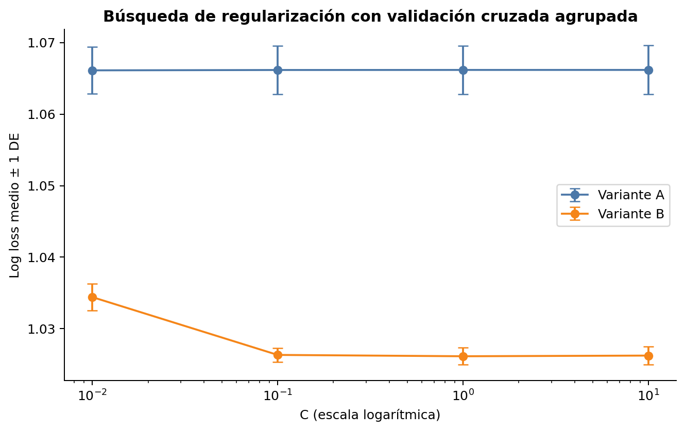
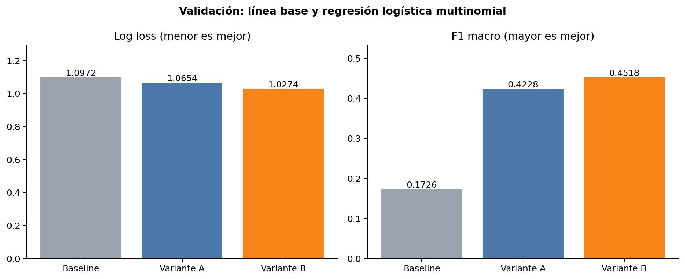
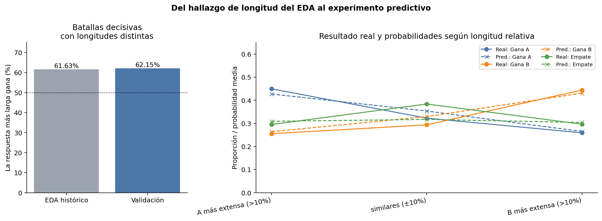
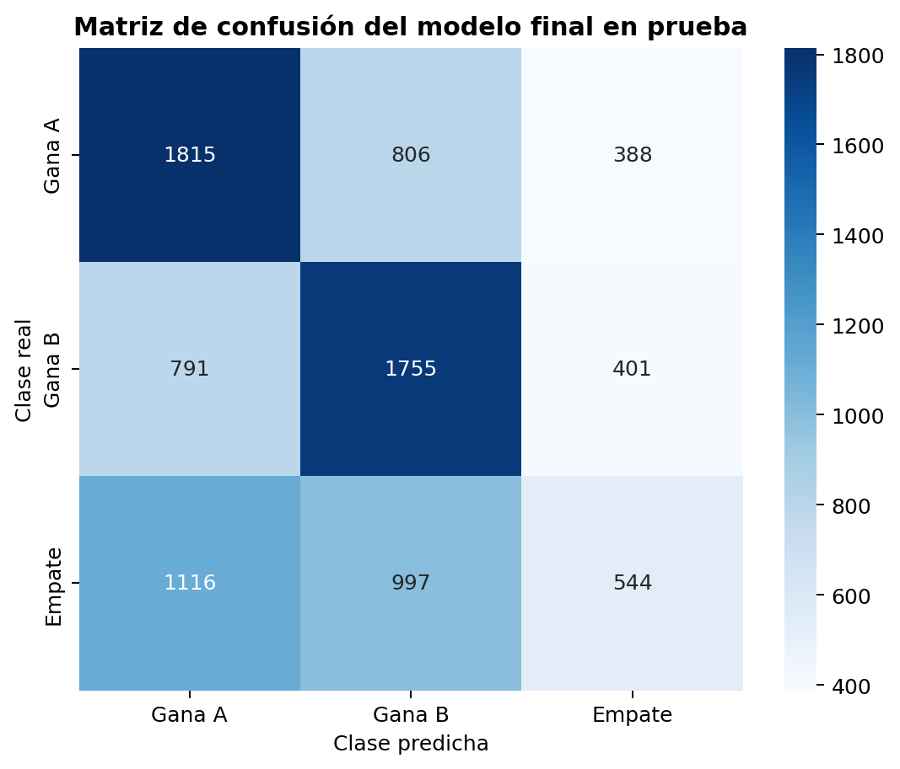
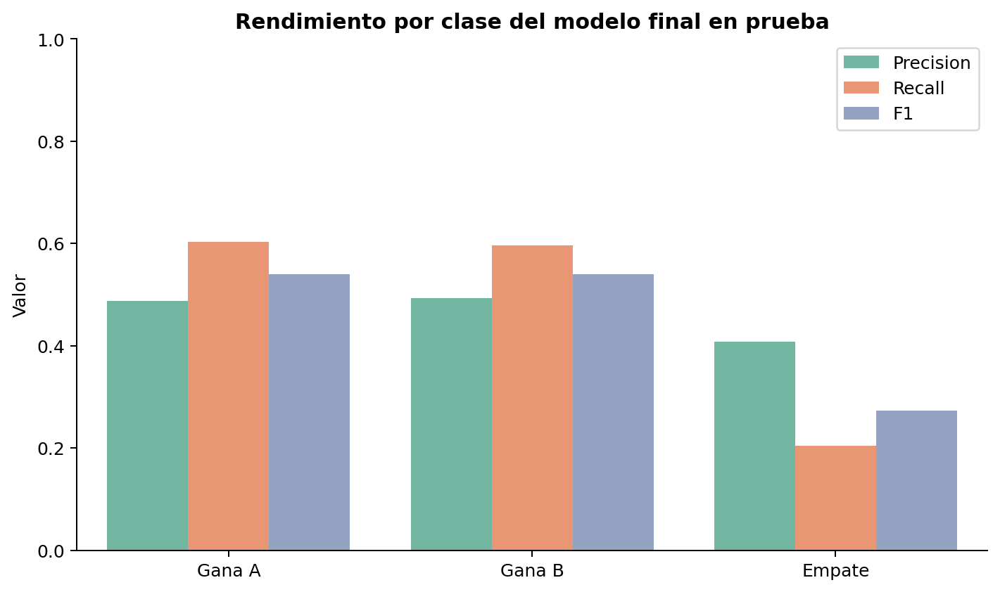
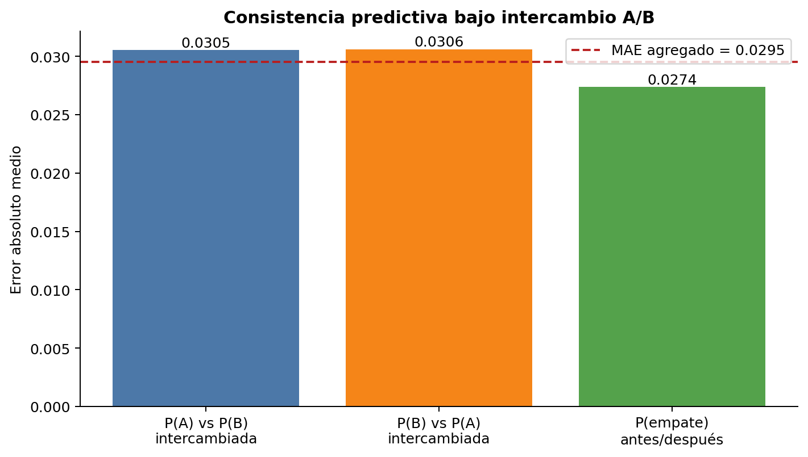

# Regresión logística multinomial para preferencias humanas en Chatbot Arena

## 1. Objetivo específico de la regresión logística

El objetivo de esta contribución es determinar hasta qué punto las longitudes del prompt y de las respuestas, sus diferencias, el número de turnos y la identidad de los modelos enfrentados permiten estimar las probabilidades de tres resultados mutuamente excluyentes: victoria de A, victoria de B y empate. La regresión logística multinomial se utiliza como una línea base interpretable, eficiente y reproducible para la comparación posterior con XGBoost, representaciones mediante *embeddings* y DeBERTa.

La investigación corresponde a la predicción de preferencias humanas en LMSYS Chatbot Arena. La mención de “compradores recurrentes” que aparece en el encabezado administrativo del reto 11 de la guía no describe el conjunto de datos ni la investigación efectivamente realizada.

## 2. Justificación a partir del EDA y la revisión bibliográfica

El análisis exploratorio previo partió de 57,477 enfrentamientos, eliminó 71 duplicados de contenido y conservó 57,406 observaciones. Las clases quedaron relativamente equilibradas: 34.94 % de victorias de A, 34.22 % de victorias de B y 30.85 % de empates. La respuesta más larga ganó el 61.63 % de las batallas decisivas cuyas longitudes eran distintas; además, `dif_len` presentó correlaciones aproximadas de +0.177 con victoria de A y −0.179 con victoria de B. Estos valores son antecedentes descriptivos y no resultados del modelo.

La revisión bibliográfica preliminar consideró regresión logística, Random Forest, XGBoost, SVM con TF–IDF, MLP, Transformers y Bradley–Terry–Davidson. El contrato técnico posterior, `docs/especificaciones_modelos.md`, concretó cuatro contribuciones comparables: regresión logística multinomial, XGBoost con variables de estilo y Bradley–Terry–Davidson, *embeddings* preentrenados y DeBERTa. Por ser la especificación más reciente y operativa, se siguió ese contrato; esta contribución implementa únicamente la regresión logística.

La elección se apoya en Böhning (1992), quien estudia el ajuste de la regresión logística multinomial. En este proyecto el modelo permite convertir las señales observadas en el EDA en probabilidades comparables y comprobar si las identidades de los rivales agregan información. Chatbot Arena, por su parte, se basa en comparaciones por pares y preferencias humanas recolectadas de forma abierta (Chiang et al., 2024).

## 3. Fundamento matemático del modelo multinomial y regularización L2

Sean las clases \(k \in \{0,1,2\}\), que representan gana A, gana B y empate, y sea \(x_i\) el vector de variables de la batalla \(i\). La probabilidad multinomial se expresa mediante *softmax*:

\[
P(Y_i=k\mid x_i)=\frac{\exp(\beta_k^\top x_i+b_k)}
{\sum_{j=0}^{2}\exp(\beta_j^\top x_i+b_j)}.
\]

El ajuste minimiza la entropía cruzada multiclase con una penalización cuadrática:

\[
\mathcal{L}(\beta)=-\sum_i\sum_k y_{ik}\log P(Y_i=k\mid x_i)
+\lambda\sum_k\lVert\beta_k\rVert_2^2.
\]

En scikit-learn, `C` controla de forma inversa la intensidad de regularización: valores pequeños implican mayor contracción. Se empleó `lbfgs`, que optimiza directamente la pérdida multinomial para tres clases. Con scikit-learn 1.8.0 se omitieron los parámetros obsoletos `multi_class` y `penalty`; el valor predeterminado `l1_ratio=0` conserva L2. El código mantiene compatibilidad con versiones anteriores, donde explicita `penalty="l2"`.

## 4. Descripción de variables y preprocesamiento

Se reutilizó `features.build_base_features(df)` sin rehacer la limpieza ni el EDA. Las variables numéricas fueron:

- `prompt_len`, `resp_a_len`, `resp_b_len`;
- `prompt_words`, `resp_a_words`, `resp_b_words`;
- `n_turns`;
- `dif_len` y `dif_words`, calculadas como A menos B;
- `log_prompt_len`, `log_resp_a_len`, `log_resp_b_len`;
- `dif_log_len`.

La Variante A utilizó solo estas trece variables. La Variante B agregó `model_a` y `model_b`. Las variables numéricas se estandarizaron mediante `StandardScaler`; las identidades se transformaron con `OneHotEncoder(handle_unknown="ignore")`. Ambos pasos quedaron dentro de un `ColumnTransformer` y un `Pipeline`, por lo que se ajustaron exclusivamente con datos de entrenamiento. Las columnas `winner`, `winner_model_a`, `winner_model_b` y `winner_tie` fueron excluidas y comprobadas mediante pruebas automatizadas.

No se eliminaron valores extremos válidos. Las transformaciones `log1p` reducen su influencia de escala sin descartar observaciones. La inferencia nueva aplica la misma unión de turnos y el mismo cálculo de caracteres, palabras y número de turnos que el notebook 02.

### Redundancia y coeficientes

En entrenamiento aparecieron correlaciones altas entre caracteres y palabras: 0.966 en el prompt, 0.989 en A, 0.985 en B y 0.976 entre `dif_len` y `dif_words`. También existe dependencia algebraica entre longitudes y diferencias. Por ello, los coeficientes no representan efectos aislados: L2 distribuye la señal entre predictores correlacionados.

Los signos estandarizados de `dif_log_len` fueron coherentes con el EDA: +0.104 para gana A, −0.108 para gana B y +0.004 para empate. `dif_len` mostró +0.050, −0.052 y +0.003, respectivamente. La coincidencia de signos respalda una asociación predictiva, pero no demuestra que una respuesta más larga tenga mayor calidad ni permite interpretar cada magnitud como un efecto causal.

## 5. Metodología experimental y particiones

Se reconstruyó `data/processed/train_clean.csv` ejecutando el notebook 02 sobre el archivo crudo disponible. Después se cargaron exclusivamente las particiones versionadas de `data/splits.csv` mediante `load.load_split`: 40,180 observaciones de entrenamiento, 8,613 de validación y 8,613 de prueba. La partición utiliza semilla 42, estratificación por clase y agrupación por `prompt_text`; no se regeneró ni modificó `splits.csv`.

El procedimiento fue:

1. Ejecutar una prueba funcional con 900 filas de entrenamiento.
2. Ajustar `C` mediante cinco folds de `StratifiedGroupKFold` únicamente en entrenamiento, agrupados por `prompt_text`.
3. Reajustar cada variante sobre todo entrenamiento con su mejor `C`.
4. Comparar baseline, Variante A y Variante B en validación.
5. Fijar la Variante B como propuesta final preespecificada antes de evaluar prueba.
6. Evaluar una sola vez el conjunto de prueba y generar los artefactos finales de la Variante B.

El baseline predice para todas las filas las proporciones de clase calculadas solo con entrenamiento. La métrica de selección fue log loss multiclase; se añadieron F1 macro, accuracy, métricas por clase, matriz de confusión y tiempos.

## 6. Optimización de hiperparámetros

Se evaluó `C = [0.01, 0.1, 1, 10]`. La tabla contiene la media y desviación estándar del log loss entre cinco folds agrupados.

| Variante | C | Log loss medio | Desviación estándar |
|---|---:|---:|---:|
| A | **0.01** | **1.066132** | 0.003288 |
| A | 0.10 | 1.066179 | 0.003390 |
| A | 1.00 | 1.066189 | 0.003407 |
| A | 10.00 | 1.066190 | 0.003409 |
| B | 0.01 | 1.034406 | 0.001883 |
| B | 0.10 | 1.026318 | 0.000989 |
| B | **1.00** | **1.026131** | 0.001187 |
| B | 10.00 | 1.026225 | 0.001234 |

Los valores elegidos fueron `C=0.01` para A y `C=1` para B. No se registraron advertencias de convergencia en ninguno de los 40 ajustes de validación cruzada ni en los dos ajustes finales.

## 7. Comparación de baseline y variantes

### Validación

El tiempo de entrenamiento incluye búsqueda de hiperparámetros y ajuste final. El tiempo de inferencia corresponde a las 8,613 observaciones de la partición.

| Modelo | Log loss | F1 macro | Accuracy | Tiempo de entrenamiento (s) | Tiempo de inferencia (s) |
|---|---:|---:|---:|---:|---:|
| Baseline de proporciones | 1.097165 | 0.172646 | 0.349472 | 0.0001 | 0.0005 |
| Variante A: numéricas | 1.065427 | 0.422762 | 0.450714 | 2.8514 | 0.0046 |
| Variante B: numéricas + modelos | **1.027420** | **0.451800** | **0.480553** | 12.1617 | 0.0147 |

Agregar identidades redujo el log loss en 0.038008 y aumentó F1 macro en 0.029038 y accuracy en 0.029839 respecto de A. La Variante B fue conservada como propuesta final, de acuerdo con el contrato técnico y con su superioridad consistente en las tres métricas de validación.

### Prueba final

| Modelo | Log loss | F1 macro | Accuracy | Tiempo de entrenamiento (s) | Tiempo de inferencia (s) |
|---|---:|---:|---:|---:|---:|
| Baseline de proporciones | 1.097168 | 0.172604 | 0.349356 | 0.0001 | 0.0001 |
| Variante A: numéricas | 1.065373 | 0.414086 | 0.439684 | 2.8514 | 0.0044 |
| Variante B: numéricas + modelos | **1.025277** | **0.450521** | **0.477650** | 12.1617 | 0.0146 |

La proximidad entre validación y prueba no muestra una degradación marcada en la partición final. Aun así, una accuracy de 47.77 % y un F1 macro de 0.451 indican que el problema dista de estar resuelto con variables tabulares.

## 8. Interpretación de resultados reales

La Variante A supera claramente al baseline en las tres métricas, lo cual comprueba que las longitudes, sus diferencias y los turnos contienen señal conjunta. La Variante B mejora adicionalmente la calidad de las probabilidades y la clasificación al representar qué modelos se enfrentan. Este resultado es coherente con el EDA, donde los 64 modelos tuvieron participaciones y tasas observadas desiguales.

La información categórica no debe convertirse en un ranking absoluto. Cada coeficiente depende de la categoría de referencia implícita, del oponente, de la posición, de la regularización y de la composición de enfrentamientos observada. Tampoco controla costo, latencia, seguridad o dificultad de la consulta.

## 9. Análisis de longitud, empates y posición

### Longitud

En validación, la respuesta más larga ganó 62.15 % de 5,947 batallas decisivas con longitudes diferentes, muy cerca del 61.63 % histórico del conjunto limpio. Cuando A fue más extensa por más de 10 %, A ganó 44.96 % de los casos; cuando B fue más extensa por más de 10 %, B ganó 44.43 %. Con longitudes similares (diferencia relativa máxima de ±10 %), el empate aumentó a 38.37 %.

| Grupo de validación | n | Accuracy | Log loss | Resultado real dominante | Probabilidad media asignada |
|---|---:|---:|---:|---|---:|
| A más extensa (>10 %) | 3,670 | 0.4940 | 1.0176 | A: 0.4496 | P(A): 0.4271 |
| Similares (±10 %) | 1,243 | 0.4377 | 1.0531 | Empate: 0.3837 | P(empate): 0.3171 |
| B más extensa (>10 %) | 3,700 | 0.4816 | 1.0285 | B: 0.4443 | P(B): 0.4310 |

El modelo reproduce la dirección general de la asociación, pero subestima los empates cuando las longitudes son parecidas. Estos patrones describen preferencia observada; no demuestran que escribir más produzca mayor calidad.

### Empates

En test, la clase empate tuvo precision 0.4081, recall 0.2047, F1 0.2727 y soporte 2,657. Solo 544 empates fueron identificados correctamente; 1,116 se clasificaron como victoria de A y 997 como victoria de B. Las victorias tuvieron recalls de 0.6032 (A) y 0.5955 (B), con F1 cercanos a 0.54. La dificultad no es solamente menor exactitud global: el error de empate se reparte hacia ambos lados, con una ligera mayor confusión hacia A.

| Clase | Precision | Recall | F1 | Support |
|---|---:|---:|---:|---:|
| Gana A | 0.4876 | 0.6032 | 0.5393 | 3,009 |
| Gana B | 0.4933 | 0.5955 | 0.5396 | 2,947 |
| Empate | 0.4081 | 0.2047 | 0.2727 | 2,657 |

### Intercambio A/B

Sobre las 8,613 filas de validación se intercambiaron modelos, textos y longitudes mediante `features.swap_ab()`. El error absoluto medio fue 0.03054 entre P(A original) y P(B intercambiado), 0.03062 entre P(B original) y P(A intercambiado), y 0.02736 para P(empate). El MAE agregado fue 0.02951, equivalente a una medida descriptiva de consistencia `1 − MAE = 0.97049`.

El modelo es bastante consistente, pero no exactamente simétrico. La identidad codificada por posición y el ajuste independiente de sus coeficientes permiten pequeñas diferencias. Esta prueba diagnostica consistencia predictiva; no demuestra un sesgo causal del evaluador.

## 10. Eficiencia computacional

La ejecución completa de la Variante B —20 ajustes de validación cruzada más el ajuste final— tomó 12.16 segundos en el ambiente utilizado. La inferencia de 8,613 observaciones tomó 0.0146 segundos en test. El pipeline serializado ocupa aproximadamente 10 KB y reprodujo las probabilidades previas con diferencia máxima igual a 0.0. Estas cifras hacen que la regresión logística sea adecuada como referencia rápida y para una aplicación interactiva; no deben extrapolarse directamente a otro hardware o versión de biblioteca.

## 11. Limitaciones del enfoque tabular

- Las variables describen extensión, turnos e identidad, pero no verifican factualidad, pertinencia, seguridad, claridad ni seguimiento de instrucciones.
- La relación lineal en el espacio transformado no captura todas las interacciones entre prompt, respuesta y rival.
- La alta colinealidad dificulta atribuir importancia independiente a caracteres, palabras, logaritmos y diferencias.
- `OneHotEncoder` permite inferir con modelos no vistos, pero sus columnas quedan en cero y el modelo pierde la señal específica de identidad.
- Las identidades reflejan el calendario desigual de enfrentamientos y no constituyen medidas causales de calidad.
- El recall bajo de empate muestra que similitud de longitud e identidad no bastan para reconocer ausencia de preferencia.
- *Embeddings* y Transformers podrían representar contenido semántico, pero este experimento no demuestra que superarán a la línea base; esa comparación corresponde a las contribuciones de los otros integrantes.

## 12. Conclusiones y respuesta a las hipótesis

| Hipótesis | Evidencia experimental | Conclusión |
|---|---|---|
| H1. La longitud contiene información para distinguir A y B. | A redujo log loss de 1.0972 a 1.0654; la respuesta más larga ganó 62.15 % en validación y los coeficientes de diferencias tuvieron signos opuestos para A/B. | **Respaldada.** Existe asociación predictiva, no causalidad ni equivalencia entre longitud y calidad. |
| H2. Las identidades mejoran las probabilidades frente a solo numéricas. | B redujo 0.0380 el log loss y aumentó 0.0290 F1 macro y 0.0298 accuracy en validación. | **Respaldada.** La identidad aporta señal adicional dentro de esta partición y este diseño. |
| H3. El empate será más difícil o tendrá errores diferentes. | En test, recall de empate 0.2047 y F1 0.2727, muy inferiores a los de A/B; 2,113 de 2,657 empates fueron enviados a A o B. | **Respaldada.** El patrón de error del empate es claramente distinto. |
| H4. Puede existir sensibilidad al intercambio A/B. | El intercambio produjo MAE agregado 0.0295, aunque la consistencia fue alta (0.9705). | **Respaldada con efecto pequeño.** No existe simetría exacta, pero el diagnóstico tampoco indica una gran inestabilidad. |
| H5. Las variables tabulares son útiles pero no capturan toda la información semántica. | B supera el baseline, pero alcanza 0.4777 de accuracy, F1 macro 0.4505 y recall de empate 0.2047 en test. | **Respaldada.** Es una referencia útil con límites claros; falta comparar directamente métodos semánticos antes de afirmar que serán mejores. |

Los resultados compatibles con el EDA son la dirección de los coeficientes de longitud, el 62.15 % de victorias de la respuesta más larga en validación y la dificultad concentrada alrededor de respuestas de longitud similar. La evidencia nueva es la mejora cuantificada por identidad de modelos, la calidad probabilística fuera de muestra, el comportamiento por clase y el MAE bajo intercambio. No apareció una contradicción fuerte con las expectativas iniciales; el resultado más severo es que el modelo reconoce apenas una quinta parte de los empates en test.

## 13. Referencias bibliográficas

Böhning, D. (1992). Multinomial logistic regression algorithm. *Annals of the Institute of Statistical Mathematics, 44*(1), 197–200. https://doi.org/10.1007/BF00048682

Chiang, W.-L., Zheng, L., Sheng, Y., Angelopoulos, A. N., Li, T., Li, D., Zhu, B., Zhang, H., Jordan, M., Gonzalez, J. E., & Stoica, I. (2024). Chatbot Arena: An open platform for evaluating LLMs by human preference. *Proceedings of the 41st International Conference on Machine Learning, 235*, 8359–8388. https://proceedings.mlr.press/v235/chiang24b.html

Equipo del Proyecto 2. (2026). *Predicción de preferencias humanas en Chatbot Arena* [Informe académico no publicado]. Universidad del Valle de Guatemala.

## Sección lista para incorporar al informe grupal

### Regresión logística multinomial: resultados

Se entrenaron dos regresiones logísticas multinomiales con regularización L2. La Variante A utilizó trece características numéricas de longitud, palabras, transformaciones logarítmicas, diferencias y número de turnos; la Variante B agregó las identidades de `model_a` y `model_b` mediante codificación *one-hot*. La regularización se seleccionó exclusivamente en entrenamiento mediante cinco folds estratificados y agrupados por prompt. Los mejores valores fueron `C=0.01` para A y `C=1` para B, sin advertencias de convergencia.

En validación, la Variante B obtuvo log loss 1.0274, F1 macro 0.4518 y accuracy 0.4806. Frente a la Variante A, la identidad de los modelos redujo el log loss en 0.0380 y aumentó F1 macro y accuracy en aproximadamente 0.029. En la evaluación final de test obtuvo log loss 1.0253, F1 macro 0.4505 y accuracy 0.4777. El resultado más débil fue el empate: precision 0.4081, recall 0.2047 y F1 0.2727. Por tanto, las variables tabulares forman una línea base útil y eficiente, pero no capturan por completo los factores que llevan a una persona a declarar igualdad entre dos respuestas.

| Modelo (validación) | Log loss | F1 macro | Accuracy |
|---|---:|---:|---:|
| Baseline | 1.0972 | 0.1726 | 0.3495 |
| Regresión logística A | 1.0654 | 0.4228 | 0.4507 |
| Regresión logística B | **1.0274** | **0.4518** | **0.4806** |

La validación reprodujo el hallazgo exploratorio de longitud: en batallas decisivas con extensiones distintas, la respuesta más larga ganó 62.15 %, frente al 61.63 % histórico. La prueba de intercambio A/B produjo un error absoluto medio agregado de 0.0295, lo que indica alta consistencia, aunque no simetría perfecta. Estas asociaciones no implican causalidad ni permiten equiparar verbosidad con calidad.
